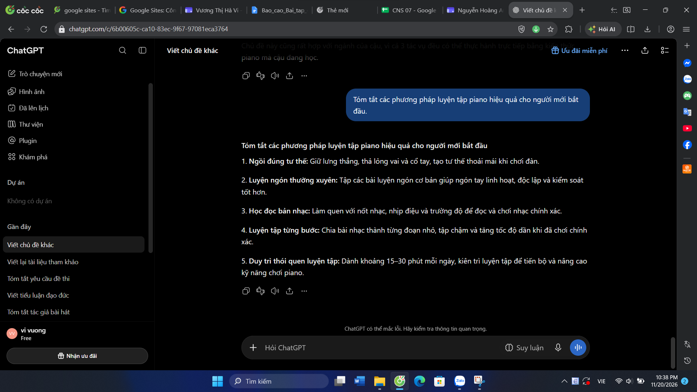
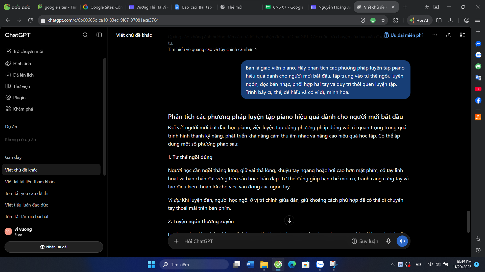
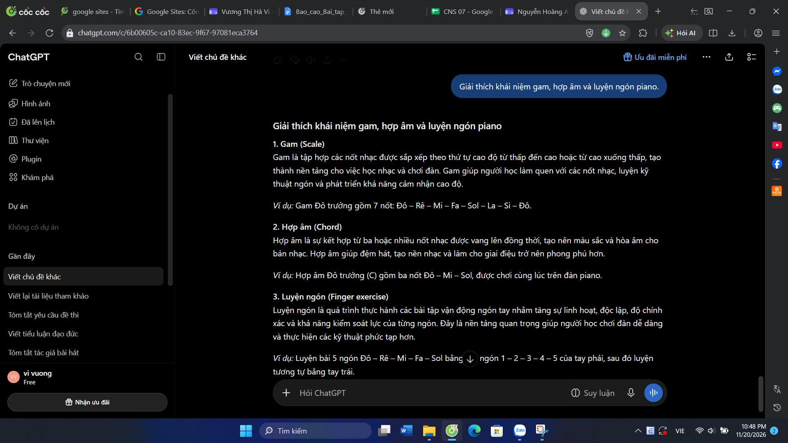
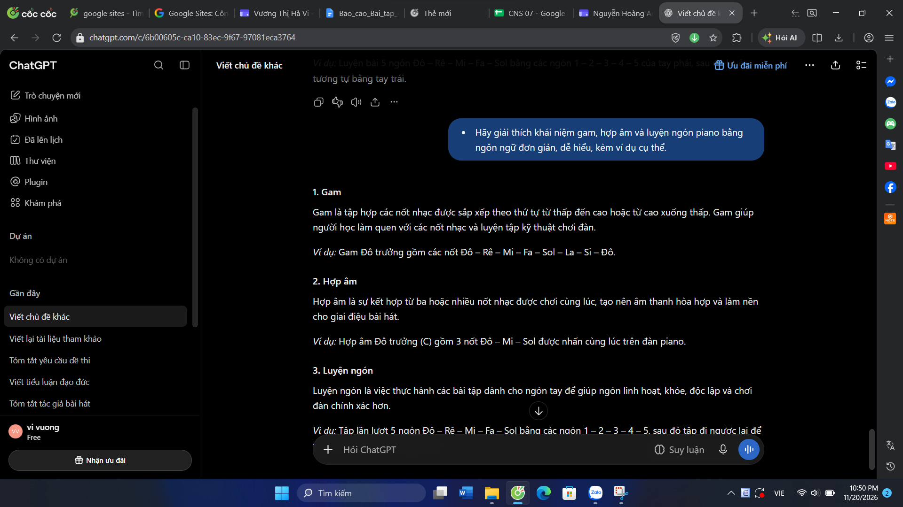
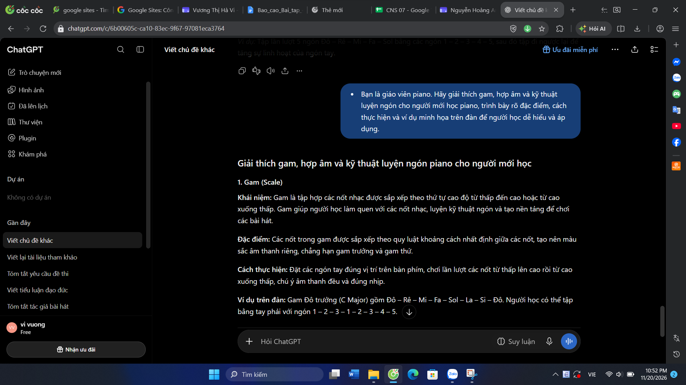
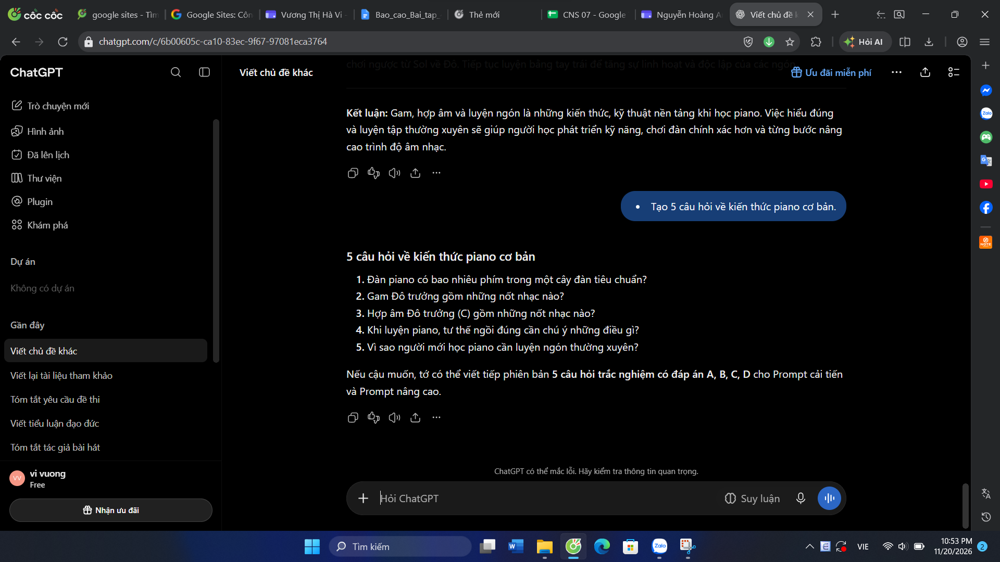
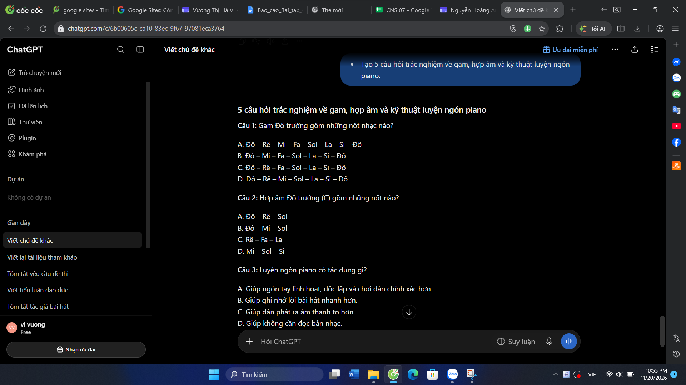
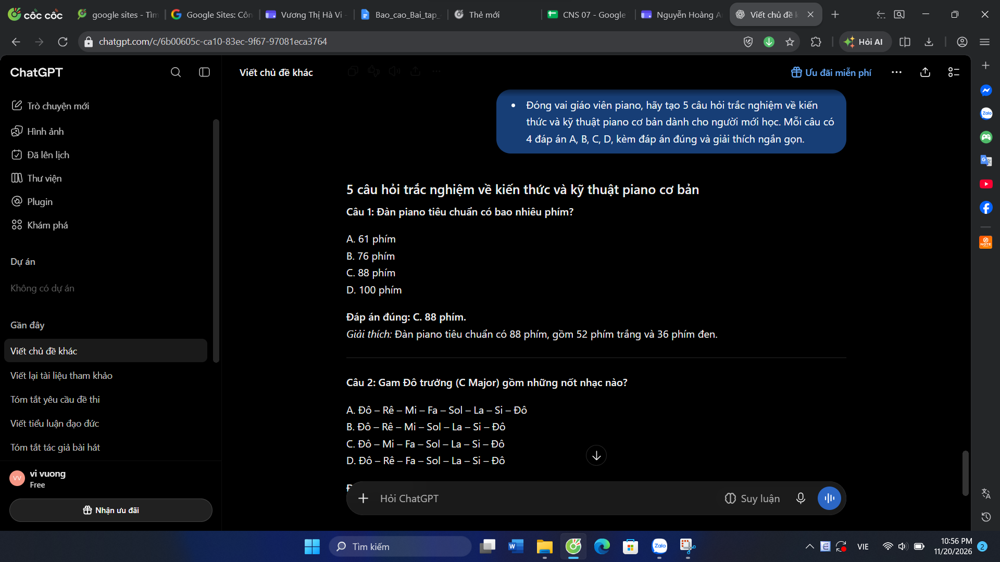

# Bài 3

<!-- LAYOUT: Google Sites page has no page-header/banner section; content starts directly with the first text section. Single-column page; text sections full width; each screenshot sits in its own centered row flanked by empty spacer columns (see per-row notes). -->

### Chương 3: Tổng quan về trí tuệ nhân tạo <!-- align: center -->

Viết Prompt hiệu quả cho các tác vụ học tập <!-- align: center -->

**I. Mục tiêu:** Phát triển kỹ năng viết Prompt hiệu quả để tận dụng tối đa khả năng của các mô hình ngôn ngữ lớn

### II. Yêu cầu:

**1. Chọn 3 tác vụ học tập phổ biến**

- **Tóm tắt nội dung:** Tóm tắt kiến thức về các phương pháp luyện tập piano hiệu quả cho người mới bắt đầu.
- **Giải thích kiến thức:** Giải thích khái niệm gam, hợp âm và luyện ngón piano.
- **Tạo câu hỏi ôn tập:** Tạo 5 câu hỏi trắc nghiệm về kỹ thuật piano cơ bản.

**2. Cho mỗi tác vụ, viết 3 phiên bản prompt khác nhau**

**- Tác vụ 1: Tóm tắt nội dung**

a. Prompt cơ bản:

- Tóm tắt các phương pháp luyện tập piano hiệu quả cho người mới bắt đầu.

b. Prompt cải tiến:

- Hãy tóm tắt các phương pháp luyện tập piano hiệu quả cho người mới bắt đầu, trình bày thành 5 ý ngắn gọn, dễ hiểu.

c. Prompt nâng cao:

- Bạn là giáo viên piano. Hãy phân tích các phương pháp luyện tập piano hiệu quả dành cho người mới bắt đầu, tập trung vào tư thế ngồi, luyện ngón, đọc bản nhạc, phối hợp hai tay và duy trì thói quen luyện tập. Trình bày cụ thể, dễ hiểu và có ví dụ minh họa.

**- Tác vụ 2: Giải thích kiến thức**

a. Prompt cơ bản:

- Giải thích khái niệm gam, hợp âm và luyện ngón piano.

b. Prompt cải tiến:

- Hãy giải thích khái niệm gam, hợp âm và luyện ngón piano bằng ngôn ngữ đơn giản, dễ hiểu, kèm ví dụ cụ thể.

c. Prompt nâng cao:

- Bạn là giáo viên piano. Hãy giải thích gam, hợp âm và kỹ thuật luyện ngón cho người mới học piano, trình bày rõ đặc điểm, cách thực hiện và ví dụ minh họa trên đàn để người học dễ hiểu và áp dụng.

**- Tác vụ 3: Tạo câu hỏi ôn tập**

a. Prompt cơ bản:

- Tạo 5 câu hỏi về kiến thức piano cơ bản.

b. Prompt cải tiến:

- Tạo 5 câu hỏi trắc nghiệm về gam, hợp âm và kỹ thuật luyện ngón piano.

c. Prompt nâng cao:

- Đóng vai giáo viên piano, hãy tạo 5 câu hỏi trắc nghiệm về kiến thức và kỹ thuật piano cơ bản dành cho người mới học. Mỗi câu có 4 đáp án A, B, C, D, kèm đáp án đúng và giải thích ngắn gọn.

**3. Thử nghiệm cac Prompt với một công cụ AI và so sánh kết quả**

-Tác vụ 1

a) Prompt cơ bản:

- Tóm tắt các phương pháp luyện tập piano hiệu quả cho người mới bắt đầu.

<!-- LAYOUT: row with 3 columns: 1/12 (empty spacer) | 10/12 | 1/12 (empty spacer) -->

<!-- IMAGE role=screenshot illustrating the text above; source has no alt text or caption (alt here is descriptive, not source text) -->

b. Prompt cải tiến:

- Hãy tóm tắt các phương pháp luyện tập piano hiệu quả cho người mới bắt đầu, trình bày thành 5 ý ngắn gọn, dễ hiểu.

<!-- LAYOUT: row with 3 columns: 1/12 (empty spacer) | 10/12 | 1/12 (empty spacer) -->

<!-- IMAGE role=screenshot illustrating the text above; source has no alt text or caption (alt here is descriptive, not source text) -->

c. Prompt nâng cao:

- Bạn là giáo viên piano. Hãy phân tích các phương pháp luyện tập piano hiệu quả dành cho người mới bắt đầu, tập trung vào tư thế ngồi, luyện ngón, đọc bản nhạc, phối hợp hai tay và duy trì thói quen luyện tập. Trình bày cụ thể, dễ hiểu và có ví dụ minh họa.

<!-- LAYOUT: row with 3 columns: 1/12 (empty spacer) | 10/12 | 1/12 (empty spacer) -->

<!-- IMAGE role=screenshot illustrating the text above; source has no alt text or caption (alt here is descriptive, not source text) -->

-Tác vụ 2

a. Prompt cơ bản:

- Giải thích khái niệm gam, hợp âm và luyện ngón piano.

<!-- LAYOUT: row with 3 columns: 1/12 (empty spacer) | 10/12 | 1/12 (empty spacer) -->

<!-- IMAGE role=screenshot illustrating the text above; source has no alt text or caption (alt here is descriptive, not source text) -->

b. Prompt cải tiến:

- Hãy giải thích khái niệm gam, hợp âm và luyện ngón piano bằng ngôn ngữ đơn giản, dễ hiểu, kèm ví dụ cụ thể.

<!-- LAYOUT: row with 3 columns: 1/12 (empty spacer) | 10/12 | 1/12 (empty spacer) -->

<!-- IMAGE role=screenshot illustrating the text above; source has no alt text or caption (alt here is descriptive, not source text) -->

c. Prompt nâng cao:

- Bạn là giáo viên piano. Hãy giải thích gam, hợp âm và kỹ thuật luyện ngón cho người mới học piano, trình bày rõ đặc điểm, cách thực hiện và ví dụ minh họa trên đàn để người học dễ hiểu và áp dụng.

<!-- LAYOUT: row with 3 columns: 1/12 (empty spacer) | 10/12 | 1/12 (empty spacer) -->

<!-- IMAGE role=screenshot illustrating the text above; source has no alt text or caption (alt here is descriptive, not source text) -->

-Tác vụ 3

a. Prompt cơ bản:

- Tạo 5 câu hỏi về kiến thức piano cơ bản.

<!-- LAYOUT: row with 3 columns: 1/12 (empty spacer) | 10/12 | 1/12 (empty spacer) -->

<!-- IMAGE role=screenshot illustrating the text above; source has no alt text or caption (alt here is descriptive, not source text) -->

b. Prompt cải tiến:

- Tạo 5 câu hỏi trắc nghiệm về gam, hợp âm và kỹ thuật luyện ngón piano.

<!-- LAYOUT: row with 3 columns: 1/12 (empty spacer) | 10/12 | 1/12 (empty spacer) -->

<!-- IMAGE role=screenshot illustrating the text above; source has no alt text or caption (alt here is descriptive, not source text) -->

c. Prompt nâng cao:

- Đóng vai giáo viên piano, hãy tạo 5 câu hỏi trắc nghiệm về kiến thức và kỹ thuật piano cơ bản dành cho người mới học. Mỗi câu có 4 đáp án A, B, C, D, kèm đáp án đúng và giải thích ngắn gọn.

<!-- LAYOUT: row with 3 columns: 1/12 (empty spacer) | 10/12 | 1/12 (empty spacer) -->

<!-- IMAGE role=screenshot illustrating the text above; source has no alt text or caption (alt here is descriptive, not source text) -->

**4. Phân tích lý do tại sao một số Prompt hiệu quả hơn**

Qua quá trình thử nghiệm 3 phiên bản Prompt về kiến thức và kỹ thuật piano, em nhận thấy:

- **Prompt cơ bản:** Cách viết đơn giản, ngắn gọn, giúp AI hiểu yêu cầu chính. Tuy nhiên, kết quả thường còn chung chung, chưa có nhiều ví dụ hoặc giải thích cụ thể về kiến thức piano.
- **Prompt cải tiến:** Đưa ra yêu cầu rõ ràng hơn về nội dung, đối tượng và cách trình bày, giúp AI tập trung vào kiến thức cần tìm hiểu. Kết quả đầy đủ hơn, dễ hiểu và phù hợp với người mới học piano.
- **Prompt nâng cao:** Sử dụng kỹ thuật phân vai (Role Prompting), yêu cầu AI đóng vai giáo viên piano, đồng thời cung cấp các yêu cầu cụ thể về đặc điểm, cách thực hiện và ví dụ minh họa. Nhờ đó, câu trả lời có tính chuyên môn, dễ áp dụng vào thực hành.
- **Kết luận:** Prompt cải tiến và nâng cao thường mang lại kết quả tốt hơn Prompt cơ bản vì có yêu cầu cụ thể, rõ ràng và định hướng nội dung. Tuy nhiên, hiệu quả còn phụ thuộc vào cách đặt câu hỏi và mục đích học tập.

**5. Tổng hợp các nguyên tắc và mẹo viết Prompt hiệu quả**

Qua quá trình thử nghiệm, em rút ra một số nguyên tắc sau:

- **Sử dụng câu lệnh rõ ràng:** Nêu chính xác nội dung cần AI thực hiện, tránh diễn đạt mơ hồ.
- **Cung cấp thông tin cụ thể:** Đưa ra chủ đề, mục đích và đối tượng học tập để AI hiểu đúng yêu cầu, chẳng hạn kiến thức piano dành cho người mới bắt đầu.
- **Xác định vai trò cho AI:** Có thể yêu cầu AI đóng vai giáo viên piano, giảng viên âm nhạc hoặc người hướng dẫn luyện tập để câu trả lời phù hợp hơn.
- **Quy định cách trình bày:** Nêu rõ số lượng ý, độ dài, cách giải thích và yêu cầu ví dụ minh họa để nội dung dễ hiểu, dễ áp dụng.
- **Điều chỉnh Prompt khi cần thiết:** Nếu kết quả chưa phù hợp, hãy bổ sung hoặc thay đổi câu lệnh để cải thiện câu trả lời, đặc biệt đối với kiến thức nhạc lý và kỹ thuật thực hành piano.
- **Kết luận:** Viết Prompt hiệu quả giúp tiết kiệm thời gian, nâng cao chất lượng câu trả lời và hỗ trợ quá trình học tập piano tốt hơn. Tuy nhiên, cần kiểm tra lại thông tin do AI cung cấp để đảm bảo tính chính xác của kiến thức âm nhạc trước khi sử dụng.
