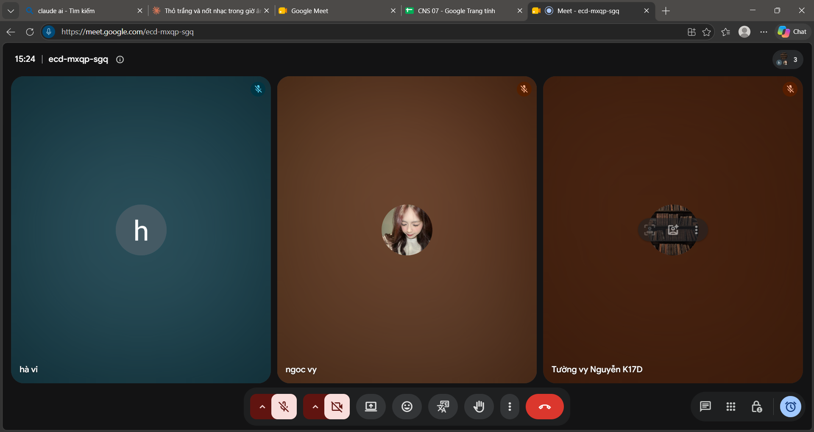
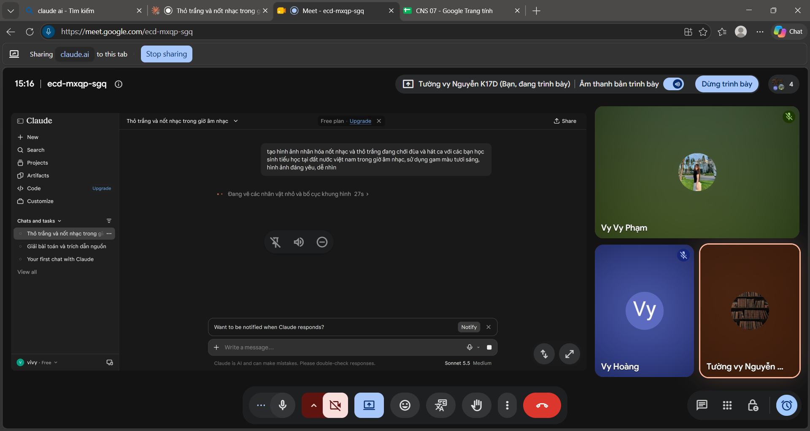
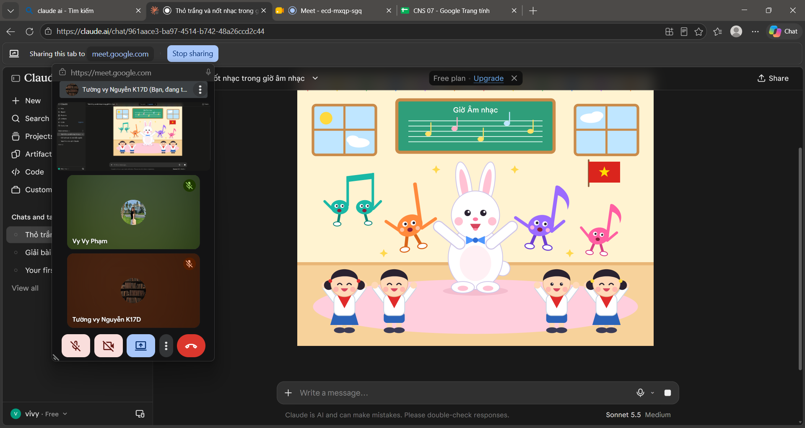

<!-- LAYOUT: On the original site this page has no text, only one full-width (12/12) Google Drive embed of the Word file (~1.27:1 frame).
     The text below was extracted from that file (content/source/bai-4/Bao_cao_Bai_tap_4_Hoan_chinh.docx), checked character-for-character against it.
     Rebuild option: render this text as the page and offer the .docx as a download / the Drive preview as a secondary view. -->

<!-- EMBED type=drive-file mime=application/vnd.openxmlformats-officedocument.wordprocessingml.document url=https://drive.google.com/file/d/1Mm5nEt5aBfDSbQQj1QPCn2FmZQegFx6s/preview view_url=https://drive.google.com/file/d/1Mm5nEt5aBfDSbQQj1QPCn2FmZQegFx6s/view name=Bao_cao_Bai_tap_4_Hoan_chinh.docx poster=../assets/bai-4/01-drive-thumbnail-bao-cao.png -->

<!-- IMAGES: 01–03-docx-image.png are the "DẪN CHỨNG CUỘC HỌP" screenshots from the report (Google Meet with group members' names and avatars). -->

<!-- align: center -->
**BÁO CÁO BÀI TẬP 4**

<!-- align: center -->
**RÈN LUYỆN KĨ NĂNG TỔ CHỨC VÀ THAM GIA CUỘC HỌP TRỰC TUYẾN CHUYÊN NGHIỆP**

| **THÔNG TIN CHUNG VỀ HOẠT ĐỘNG NHÓM**   Tên nhóm làm việc: Nhóm Cns tối chủ nhật (Gồm 6 thành viên tham gia thực hiện bài tập)   Chủ đề thảo luận & thuyết trình: Ứng dụng Trí tuệ nhân tạo (AI) trong dạy học môn Âm nhạc ở bậc Tiểu học   Công cụ tổ chức họp trực tuyến: Google Meet (Kết hợp kênh trao đổi điều phối nhanh qua nhóm Zalo vào tối chủ nhật)   Thời gian họp trực tuyến: Từ 20:00 đến 21:00, ngày 15/11/2026 |
|---|

**I. KẾ HOẠCH CUỘC HỌP**

**1. Mục tiêu và yêu cầu cuộc họp**

Cuộc họp trực tuyến được tổ chức nhằm thống nhất cấu trúc nội dung, phân công nhiệm vụ cụ thể cho từng thành viên và khớp nối kịch bản thuyết trình cho chủ đề "Ứng dụng Trí tuệ nhân tạo (AI) trong dạy học môn Âm nhạc ở tiểu học". Thông qua buổi họp, nhóm đặt mục tiêu đảm bảo bài thuyết trình có mạch triển khai logic, bám sát thực tiễn giảng dạy tại trường tiểu học, đồng thời kiểm soát chặt chẽ tổng thời lượng trình bày khoảng 4,5 phút (tương đương 1,5 phút cho mỗi phần nội dung chính).

Bên cạnh mục tiêu chuyên môn, cuộc họp còn là hoạt động thực hành quy trình tổ chức và vận hành một phiên làm việc trực tuyến chuyên nghiệp trên nền tảng Google Meet: có người điều hướng giữ nhịp thảo luận, thư ký ghi chép biên bản, các thành viên báo cáo phần tài liệu chuẩn bị và thống nhất sản phẩm minh họa thực tế trước hạn nộp bài.

**2. Thời gian, hình thức và thành phần tham dự**

**• Thời gian tổ chức:** 20:00 – 21:00, ngày 15/11/2026 (Chuẩn bị trước 10 phút để kiểm tra đường truyền, micro và chia sẻ màn hình).

**• Hình thức và nền tảng:** Họp trực tuyến qua Google Meet; trao đổi tài liệu, phân công trước giờ họp và chốt hạn nộp sản phẩm quay dựng qua nhóm Zalo "Cns Tối T7".

**• Thành phần tham dự:** Đầy đủ 06 thành viên của nhóm gồm: Đoàn Phương Vy (Người điều hướng), Vương Thị Hà Vi (Thuyết trình Phần 1 & 2), Nguyễn Tường Vy (Thuyết trình Phần 3 & Tạo dẫn chứng bằng AI), Hoàng Khánh Vy (Chuẩn bị tài liệu Phần 1), Vy Vy Phạm (Thư ký & Chuẩn bị tài liệu Phần 2), Ngọc Vy (Chuẩn bị tài liệu Phần 3).

**• Hạn hoàn thành sản phẩm sau họp:** Các thành viên hoàn thiện phần quay thuyết trình và gửi về cho bạn Nguyễn Tường Vy muộn nhất là 17:00 (5 giờ chiều) ngày hôm sau (16/11/2026) để tổng hợp.

**3. Công tác chuẩn bị trước cuộc họp**

**▪  Người điều hướng (Nguyễn Tường Vy):** Xây dựng khung kịch bản gồm 3 phần nối tiếp theo tiến trình một tiết dạy âm nhạc ở tiểu học, phân bổ thời lượng 1,5 phút/phần và gửi lên nhóm Zalo để các thành viên rà soát trước.

**▪  Người thuyết trình (Vương Thị Hà Vi & Nguyễn Tường Vy):** Chuẩn bị sẵn nội dung chi tiết cho Phần 1 & Phần 2, kiểm tra độ trôi chảy khi đọc lời dẫn và đối chiếu ý kiến góp ý cùng các thành viên phụ trách tài liệu.

**▪  Nhóm chuẩn bị tài liệu (Hoàng Khánh Vy, Vy Vy Phạm, Ngọc Vy):** Sưu tầm tư liệu, biên soạn ví dụ minh họa cho từng phần (lời đồng dao/bài hát ngắn, nhạc nền/tiết tấu, mô tả nhân vật và tranh minh họa âm nhạc) để trình bày trong cuộc họp.

**▪  Thư ký cuộc họp (Phạm Thị Vy):** Chuẩn bị biểu mẫu ghi chép biên bản cuộc họp, hỗ trợ tổng hợp và tóm tắt các ý chính của nội dung thảo luận bằng công cụ AI để hoàn thiện hồ sơ báo cáo.

**4. Chương trình (Agenda) dự kiến của cuộc họp**

| **Thời gian** | **Nội dung phiên họp** | **Người phụ trách** | **Kết quả đầu ra dự kiến** |
|---|---|---|---|
| **20:00 – 20:05   (5 phút)** | Ổn định phòng họp Google Meet, điểm danh thành viên, kiểm tra âm thanh/chia sẻ màn hình và công bố mục tiêu cuộc họp. | Nguyễn Tường Vy   (Điều hướng) | 100% thành viên có mặt, thống nhất quy tắc phát biểu và mục tiêu buổi họp. |
| **20:05 – 20:15   (10 phút)** | Giới thiệu tổng quan chủ đề "Ứng dụng AI trong dạy học âm nhạc ở tiểu học" và rà soát khung kịch bản 3 phần. | Đoàn Phương Vy &   Vương Thị Hà Vi | Chốt mạch dẫn nhập mở đầu và cấu trúc 3 phần (1,5 phút/phần). |
| **20:15 – 20:35   (20 phút)** | Thảo luận chi tiết nội dung Phần 1 (Hỗ trợ soạn bài, viết lời đồng dao) và Phần 2 (Tạo nhạc nền, phối khí, minh họa âm thanh). | Vương Thị Hà Vi,   Hoàng Khánh Vy, Phạm Thị Vy | Hoàn thiện lời thuyết trình Phần 1 & 2, chốt ví dụ minh họa và nhạc đệm. |
| **20:35 – 20:50   (15 phút)** | Thảo luận nội dung Phần 3 (Tạo hình ảnh, nhân vật, kể chuyện trực quan) và thống nhất phương án tạo dẫn chứng bằng AI. | Nguyễn Tường Vy &   Ngọc Vy | Chốt hình tượng nhân vật dẫn dắt và bộ tranh minh họa tính chất âm nhạc. |
| **20:50 – 21:00   (10 phút)** | Thư ký tổng hợp ý chính, chốt phân công quay video thuyết trình, thống nhất mốc thời gian nộp bài (17:00 ngày hôm sau). | Phạm Thị Vy &   Nguyễn Tường Vy | Biên bản thống nhất phân công nhiệm vụ và lịch trình hoàn thiện sản phẩm. |

**II. BIÊN BẢN CUỘC HỌP**

**1. Thông tin hành chính phiên họp**

**• Tên cuộc họp:** Họp nhóm triển khai bài tập thuyết trình chủ đề "Ứng dụng Trí tuệ nhân tạo (AI) trong dạy học Âm nhạc ở Tiểu học".

**• Thời gian bắt đầu – kết thúc:** Bắt đầu lúc 20:00, kết thúc lúc 21:00, chủ Nhật, ngày 15/11/2026.

**• Địa điểm / Nền tảng:** Phòng họp trực tuyến Google Meet (Kèm kênh điều phối tin nhắn nhóm Zalo Cns Tối T7).

**• Chủ trì (Người điều hướng):** Đoàn Phương Vy.

**• Thư ký ghi biên bản:** Phạm Thị Vy

**• Thành viên tham dự:** Có mặt 05/06 thành viên (Vương Thị Hà Vi, Nguyễn Tường Vy, Hoàng Khánh Vy, Phạm Thị Vy, Ngọc Vy). Vắng mặt: 1- Đoàn Phương Vy,

**2. Diễn biến chi tiết nội dung thảo luận**

Mở đầu cuộc họp lúc 20:00, bạn Nguyễn Tường Vy với vai trò Người điều hướng thực hiện điểm danh, kiểm tra chất lượng đường truyền của các thành viên trên Google Meet và tuyên bố lý do buổi họp. Theo kịch bản mở đầu đã thống nhất, người điều hướng xác định rõ mạch dẫn nhập vào chủ đề: nhóm tập trung tìm hiểu các giải pháp ứng dụng trí tuệ nhân tạo (AI) nhằm hỗ trợ giáo viên tiểu học nâng cao hiệu quả giảng dạy môn Âm nhạc, sau đó chuyển quyền trình bày chính cho bạn Vương Thị Hà Vi.

Tiếp theo, bạn Vương Thị Hà Vi trình bày dự thảo nội dung Phần 1 và Phần 2, đồng thời thảo luận cùng nhóm chuẩn bị tài liệu (Hoàng Khánh Vy và Vy Vy Phạm) để hoàn thiện chi tiết từng mục:

**▪  Nội dung 1 – Hỗ trợ soạn bài, viết lời đồng dao và bài hát ngắn (Khoảng 1,5 phút):** Tập trung vào khâu chuẩn bị giáo án của giáo viên. Nhóm thống nhất làm rõ cách các công cụ AI tạo văn bản hỗ trợ gợi ý ý tưởng trò chơi âm nhạc, câu chuyện dẫn dắt vào bài học hoặc sáng tác lời mới dựa trên giai điệu quen thuộc (như chủ đề an toàn giao thông, giữ gìn vệ sinh trường lớp, chào đón năm học mới). Đặc biệt, nhóm nhấn mạnh nguyên tắc sư phạm cốt lõi: AI chỉ giúp tiết kiệm thời gian lên ý tưởng ban đầu, còn giáo viên luôn là người trực tiếp biên tập lại để câu chữ ngắn gọn, tự nhiên và vừa sức với vốn từ của học sinh từng khối lớp.

**▪  Nội dung 2 – Tạo nhạc nền, phối khí và minh họa âm thanh (Khoảng 1,5 phút):** Tập trung vào khâu xử lý âm thanh và nhạc đệm trong tiết học. Ở bậc tiểu học, việc tự phối khí hoặc dựng nhạc nền cho tiết mục văn nghệ, trò chơi vận động hay kể chuyện theo nhạc đòi hỏi nhiều thời gian và kĩ thuật. Nhờ các công cụ AI tạo nhạc, giáo viên có thể tạo nhanh những đoạn nhạc nền vui tươi, tiết tấu rõ ràng theo đúng tâm trạng hoặc chủ đề bài học, giúp học sinh dễ cảm nhận nhịp điệu, dễ bắt nhịp và hào hứng hơn khi thực hành hát kết hợp vận động.

Sau phần trình bày của bạn Hà Vi, bạn Nguyễn Tường Vy tiếp nối thảo luận và chốt phương án triển khai Phần 3 cùng sự hỗ trợ tài liệu từ bạn Ngọc Vy:

**▪  Nội dung 3 – Tạo hình ảnh, nhân vật và kể chuyện trực quan (Khoảng 1,5 phút):** Tập trung vào đặc điểm tâm lý tiếp nhận của học sinh tiểu học – lứa tuổi học tập hiệu quả nhất thông qua hình ảnh trực quan và câu chuyện sinh động. Nhóm thống nhất dùng AI tạo ảnh để minh họa nội dung bài hát, xây dựng các nhân vật đồng hành gần gũi như "Bạn Nốt Nhạc" hoặc "Chú Thỏ Giữ Nhịp", cùng hình ảnh nhạc cụ đặt trong bối cảnh sinh động. Thay vì chỉ nhìn văn bản khô khan trên bảng, học sinh được quan sát hình ảnh gắn liền với âm thanh để nhận biết rõ tính chất âm nhạc như vui tươi hay trầm lắng, tiết tấu nhanh hay chậm.

Trong phần trao đổi cuối phiên họp, bạn Nguyễn Tường Vy chủ động nhận nhiệm vụ sử dụng công cụ AI để tạo bộ dẫn chứng hình ảnh trực quan phục vụ cho Phần 3, đồng thời gửi bản nháp kịch bản lên nhóm để bạn Vương Thị Hà Vi kiểm tra lại sự liền mạch giữa các phần. Bạn Vy Vy Phạm nhận trách nhiệm thư ký, tổng hợp toàn bộ nội dung thảo luận, dùng công cụ AI hỗ trợ tóm tắt các ý chính để hoàn thiện hồ sơ biên bản và báo cáo nhóm.

**3. Bảng tổng hợp quyết nghị và phân công nhiệm vụ sau cuộc họp**

| **Hạng mục công việc** | **Người phụ trách** | **Yêu cầu chất lượng / Nội dung cụ thể** | **Thời hạn hoàn thành** |
|---|---|---|---|
| **Quay lời dẫn điều hướng mở đầu cuộc họp** | Nguyễn Tường Vy | Giới thiệu chủ đề buổi họp, định hướng mạch trình bày 3 phần và mời thuyết trình viên. | Trước 17:00   ngày 16/11/2026 |
| **Quay video thuyết trình Phần 1 & Phần 2** | Vương Thị Hà Vi   (Phối hợp Khánh Vy, Phạm Vy) | Trình bày rõ ràng, đúng thời lượng ~1,5 phút/phần; làm nổi bật vai trò biên tập của giáo viên và tính ứng dụng nhạc đệm. | Trước 17:00   ngày 16/11/2026 |
| **Tạo dẫn chứng hình ảnh AI & quay thuyết trình Phần 3** | Nguyễn Tường Vy   (Phối hợp Ngọc Vy) | Tạo hình ảnh nhân vật (Bạn Nốt Nhạc, Chú Thỏ Giữ Nhịp), minh họa sắc thái âm nhạc và quay video phần 3 (~1,5 phút). | Trước 17:00   ngày 16/11/2026 |
| **Tổng hợp ý chính & hoàn thiện biên bản thư ký** | Phạm Thị Vy | Tóm tắt các ý chính từ nội dung thảo luận bằng AI, rà soát câu chữ và hoàn thiện báo cáo nhóm. | Trước 17:00   ngày 16/11/2026 |
| **Thu thập file quay & dựng sản phẩm hoàn chỉnh** | Nguyễn Tường Vy | Tiếp nhận toàn bộ video của các thành viên, kiểm tra đồng bộ âm thanh – hình ảnh và xuất bản hoàn chỉnh. | Sau 17:00   ngày 17/11/2026 |

*Cuộc họp kết thúc vào lúc 21:00 cùng ngày. Toàn bộ 05 thành viên nhất trí cao với nội dung biên bản và mốc thời gian bàn giao sản phẩm.*

**III. ĐÁNH GIÁ CỦA CÁC THÀNH VIÊN**

Sau khi kết thúc cuộc họp trực tuyến trên Google Meet và rà soát tiến độ phối hợp công việc, nhóm đã tiến hành tổng hợp chức năng đảm nhận, ý kiến đóng góp chuyên môn cũng như mức độ hoàn thành nhiệm vụ của từng thành viên trong bảng đánh giá chi tiết dưới đây:

| **STT** | **Thành viên** | **Chức năng đảm nhận** | **Ý kiến đóng góp chi tiết** | **Đánh giá mức độ đóng góp** |
|---|---|---|---|---|
| **1** | **Nguyễn Tường  Vy** | Người điều hướng | Định hướng cấu trúc báo cáo theo mạch tự nhiên của một tiết dạy âm nhạc ở tiểu học: soạn ý tưởng & lời bài hát → làm nhạc nền & tiết tấu → trực quan hóa bằng hình ảnh, nhân vật. Nhắc nhở nhóm giữ đúng thời lượng khoảng 1,5 phút/phần để bài trình bày súc tích, đồng thời làm nổi bật vai trò trung tâm của giáo viên khi dùng AI. | Hoàn thành xuất sắc   (Chủ động điều phối, giữ nhịp họp hiệu quả) |
| **2** | **Vương Thị Hà Vi** | Thuyết trình Phần 1 & Phần 2 | Đề xuất nhấn mạnh rõ ranh giới giữa ý tưởng do AI gợi ý và sự biên tập lại của giáo viên ở Phần 1 để tránh hiểu lầm AI thay thế khâu soạn bài sư phạm. Gợi ý chuyển giọng điệu hào hứng, rõ nhịp ở Phần 2 khi nói về trò chơi vận động và thực hành hát kết hợp vận động. | Hoàn thành xuất sắc   (Nội dung mạch lạc, kiểm tra chéo kịch bản tốt) |
| **3** | **Nguyễn Tường Vy** | Thuyết trình Phần 3 & Tạo dẫn chứng bằng AI | Chủ động đảm nhận việc tạo dẫn chứng hình ảnh bằng AI cho Phần 3, tập trung vào nhân vật dẫn dắt (Bạn Nốt Nhạc, Chú Thỏ Giữ Nhịp) và tranh minh họa đối lập tính chất âm nhạc (vui tươi/trầm lắng, nhanh/chậm). Đề xuất phong cách hình ảnh tươi sáng, gần gũi với học sinh tiểu học để các em dễ liên kết với sắc thái âm thanh. | Hoàn thành xuất sắc   (Tích cực tạo tư liệu AI & đôn đốc tiến độ chung) |
| **4** | **Hoàng Khánh Vy** | Chuẩn bị tài liệu Phần 1 | Đề xuất chuẩn bị ví dụ thực tế theo 3 chủ đề quen thuộc (an toàn giao thông, giữ vệ sinh trường lớp, chào đón năm học mới) kèm phần so sánh trước và sau khi giáo viên chỉnh sửa từ ngữ. Lưu ý phân loại mức độ câu chữ theo khối lớp để làm rõ sự phù hợp với vốn từ từng lứa tuổi. | Hoàn thành tốt   (Tư liệu sát thực tế tiểu học, có chiều sâu sư phạm) |
| **5** | **Phạm Thị Vy** | Thư ký & Chuẩn bị tài liệu Phần 2 | Với vai trò thư ký, ghi nhận đầy đủ ý kiến thống nhất trong cuộc họp để tổng hợp báo cáo rõ ràng, bám sát chức năng từng người. Với vai trò chuẩn bị tài liệu Phần 2, đề xuất chọn lọc các đoạn nhạc nền có tiết tấu rõ ràng, vui tươi, dễ bắt nhịp cho văn nghệ, trò chơi vận động và kể chuyện theo nhạc. | Hoàn thành xuất sắc   (Ghi chép đầy đủ, ứng dụng AI tóm tắt ý chính tốt) |
| **6** | **Ngọc Vy** | Chuẩn bị tài liệu Phần 3 | Đề xuất xây dựng bộ mô tả chi tiết ngoại hình nhân vật (Bạn Nốt Nhạc, Chú Thỏ Giữ Nhịp), bối cảnh nhạc cụ và các cặp đối lập tính chất âm nhạc (vui tươi – trầm lắng, nhanh – chậm) làm tài liệu nền cho Phần 3. Nhấn mạnh việc gắn hình ảnh trực tiếp với nội dung bài học để học sinh dễ cảm nhận thay vì chỉ nhìn chữ trên bảng. | Hoàn thành tốt   (Xây dựng bộ mô tả trực quan rõ ràng, sáng tạo) |

**IV. BÀI HỌC KINH NGHIỆM**

Thông qua quá trình lập kế hoạch, tổ chức cuộc họp trực tuyến trên Google Meet và phối hợp hoàn thiện bài tập nhóm về ứng dụng AI trong dạy học môn Âm nhạc ở tiểu học, các thành viên đã rút ra những bài học kinh nghiệm thiết thực cho việc tổ chức họp trực tuyến và làm việc nhóm chuyên nghiệp:

**▪  1. Chuẩn bị kỹ lưỡng tài liệu và phân bổ thời lượng trước cuộc họp:** Việc thống nhất trước khung kịch bản và chia nhỏ bài trình bày thành 3 phần rõ ràng (mỗi phần khoảng 1,5 phút) trên nhóm Zalo trước giờ họp giúp cuộc họp trên Google Meet đi thẳng vào trọng tâm, tiết kiệm thời gian giải thích lan man và nâng cao chất lượng phản biện.

**▪  2. Phân công rõ ràng vai trò điều phối, thuyết trình và thư ký:** Phân tách rạch ròi vai trò của người điều hướng (Đoàn Phương Vy), người thuyết trình (Hà Vi, Tường Vy), nhóm chuẩn bị tài liệu (Khánh Vy, Phạm Vy, Ngọc Vy) và thư ký (Vy Vy Phạm) giúp buổi họp vận hành trơn tru, tránh chồng chéo công việc và đảm bảo mọi nội dung đều có người chịu trách nhiệm đến cùng.

**▪  3. Kết hợp linh hoạt công cụ họp trực tuyến với kênh trao đổi nhanh:** Trong quá trình làm việc nhóm, việc kết hợp họp trực tuyến trên Google Meet để thảo luận trực tiếp, kiểm tra giọng điệu thuyết trình với kênh nhắn tin Zalo để ghim thông báo, nhắc hạn nộp (17:00 ngày hôm sau) và rà soát bản nháp giúp duy trì sự kết nối liên tục và kỷ luật tiến độ.

**▪  4. Ứng dụng công cụ AI đúng mục đích và đề cao vai trò kiểm duyệt của con người:** Cả trong nội dung chuyên môn (dùng AI gợi ý lời bài hát, tạo nhạc nền, minh họa nhân vật âm nhạc nhưng vẫn giữ vai trò biên tập sư phạm của giáo viên) lẫn trong khâu vận hành nhóm (dùng AI hỗ trợ thư ký tóm tắt ý chính cuộc họp và tạo hình ảnh dẫn chứng), nhóm nhận thức sâu sắc rằng AI là trợ thủ đắc lực giúp tăng tốc độ xử lý công việc, nhưng tư duy chọn lọc và kiểm duyệt của con người mới quyết định chất lượng sản phẩm cuối cùng.

**▪  5. Tinh thần chủ động hỗ trợ và kiểm tra chéo giữa các thành viên:** Sự chủ động tương tác, sẵn sàng nhận phần việc khó (như tạo dẫn chứng hình ảnh AI) và thói quen kiểm tra chéo sản phẩm giữa các thành viên (nhờ bạn cùng nhóm rà soát lại phần nội dung đã chuẩn bị trước khi quay) là yếu tố then chốt tạo nên một tập thể làm việc gắn kết và hiệu quả.

<!-- align: center -->
DẪN CHỨNG CUỘC HỌP

<!-- align: center -->

<!-- align: center -->

<!-- align: center -->

| **THƯ KÝ CUỘC HỌP   (Ghi biên bản và tổng hợp báo cáo)**   ***Phạm Thị Vy*** | **NGƯỜI ĐIỀU HƯỚNG   (Chủ trì cuộc họp và duyệt nội dung)**   ***Nguyễn Tường Vy*** |
|---|---|
