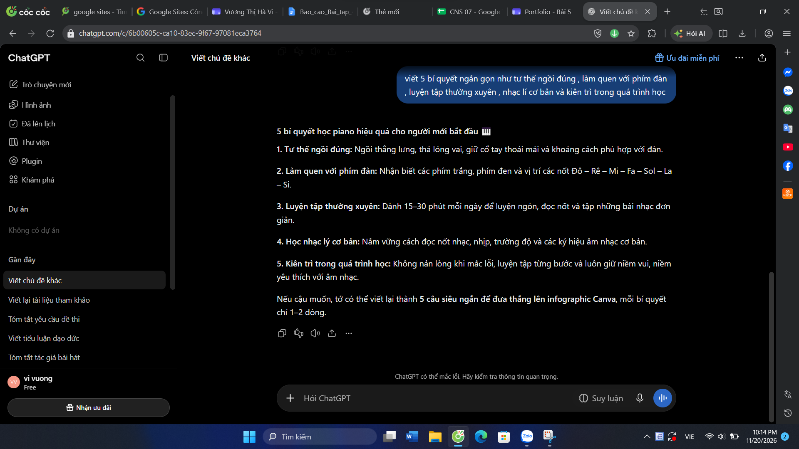
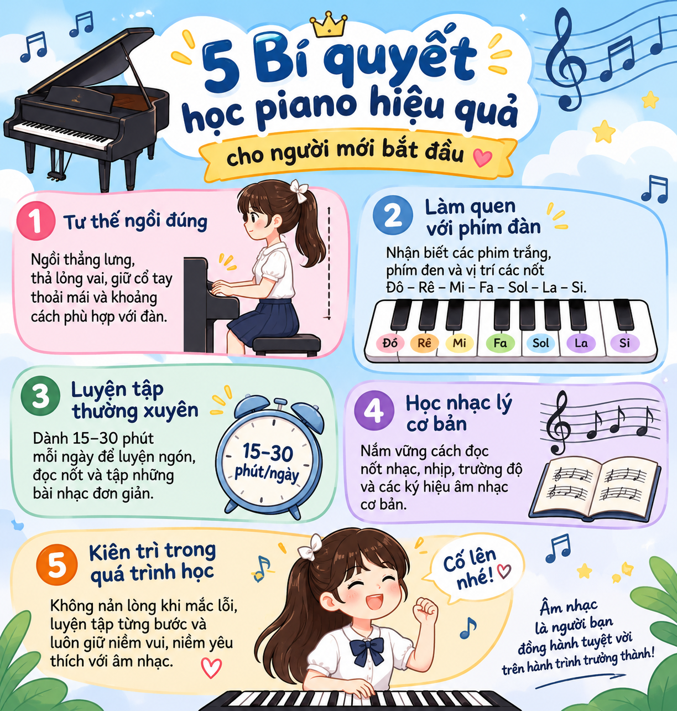

<!-- LAYOUT: No title/banner header section. Section 1: one full-width (12/12) text box. Following sections each hold one item in an offset column: image 1 in an 11/12 column (1/12 empty left gutter), caption 5.1 in a 10/12 column (2/12 gutter), image 2 in a 10/12 column (2/12 gutter), caption 5.2 in a 9/12 column (3/12 gutter). Text styled Arial 12pt black (heading 14pt bold); captions Lato italic, color #212121. -->

### Chương 5: Sáng tạo nội dung số (mục 5.4)

**a) Mục tiêu:** Sử dụng công cụ Trí tuệ nhân tạo (AI) để hỗ trợ xây dựng ý tưởng và thiết kế một Infographic mang tên *“Bí quyết học piano hiệu quả cho người mới bắt đầu”* nhằm chia sẻ phương pháp học đàn và giúp người mới tiếp cận piano dễ dàng hơn. Năng lực rèn luyện: kỹ năng viết prompt cho AI tạo sinh văn bản, chọn lọc và biên tập nội dung, sử dụng AI hỗ trợ thiết kế hình ảnh trực quan.

**b) Quá trình thực hiện**

**1. Lên ý tưởng nội dung:** Sử dụng Chat GPT để gợi ý các phương pháp học piano hiệu quả cho người mới bắt đầu. Sau đó, chọn lọc và tổng hợp thành 5 bí quyết ngắn gọn như: tư thế ngồi đúng, làm quen với các phím đàn, luyện tập thường xuyên, học nhạc lý cơ bản và kiên trì trong quá trình học.

**2. Tạo bố cục hình ảnh:** Sử dụng tính năng AI của Canva (Magic Design) nhập từ khóa để tạo nhanh bố cục Infographic dọc, bao gồm các mục nội dung, hình minh họa đàn piano và vị trí trình bày thông tin.

**3. Biên tập và hoàn thiện:** Tự điều chỉnh màu sắc theo phong cách nhẹ nhàng, phù hợp với chủ đề âm nhạc; lựa chọn phông chữ dễ đọc, bổ sung hình ảnh minh họa và kiểm tra lại nội dung để đảm bảo tính chính xác, thẩm mỹ và dễ hiểu.

**4. Sản phẩm hoàn thiện:** Tạo Infographic chia sẻ 5 bí quyết học piano hiệu quả cho người mới bắt đầu, kết hợp hình ảnh minh họa và nội dung ngắn gọn nhằm giúp người xem dễ tiếp thu và áp dụng vào quá trình luyện tập.

**c) Sản phẩm và minh chứng**

<!-- Image role: screenshot (1920x1080) of a ChatGPT conversation generating "5 bí quyết học piano hiệu quả cho người mới bắt đầu". -->

*Hình 5.1 - Nhập prompt yêu cầu Chat GPT gợi ý ý tưởng và nội dung cho Infographic.*

<!-- Image role: final product, the infographic (1224x1285). -->

*Hình 5.2 - Sản phẩm Infographic "Bí quyết học Piano hiệu quả cho người mới bắt đầu " hoàn chỉnh.*
