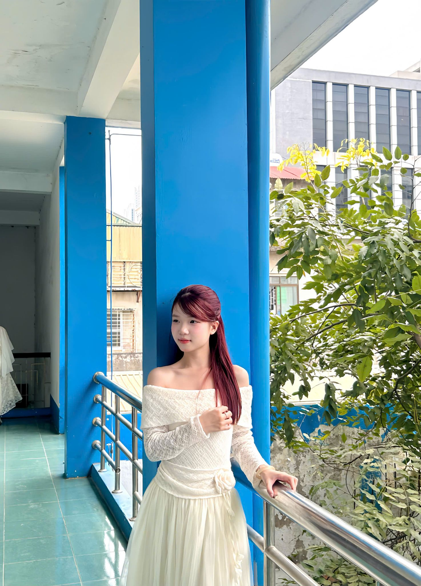

<!-- LAYOUT: Home page = one hero section (Google Sites "large header" section, min-height ~340px, padding 60px top/bottom).
     Full-bleed background image = banner (01-banner.jpg, background-size: cover, centered), with a dark #212121 overlay; all text WHITE.
     Inside: two equal-width columns side by side (~50/50): LEFT = text block, RIGHT = portrait photo. Stack on mobile.
     Text font: Nunito; paragraphs line-height ~1.8. -->

<!-- IMAGE role=banner: section background image, no alt/caption. Photo of a modern white/blue multi-storey university
     building seen through trees with red flamboyant flowers. 1264x842 JPEG (native size; =w2400 did not upscale). -->

<!-- LAYOUT: column 1 of 2 (left) -->

<!-- LAYOUT: greeting line is larger text (~17-18pt), not bold -->
Xin chào tôi tên là Vương Thị Hà Vi 

Sinh viên ngành sư phạm âm nhạc , Trường Đại học Sư phạm Nghệ thuật trung ương 

Mã sinh viên : 2552210219

**Mục tiêu học tập :**

Không chỉ học tốt kiến thức chuyên ngành mà còn biết kết hợp âm nhạc với công nghệ hiện đại, phát triển năng lực tự học và nghiên cứu để phục vụ công việc giảng dạy trong tương lai , đạt đầu ra tiếng anh ở **mức B1**

**Định hướng phát triển :**

Tôi mong muốn phát triển bản thân theo hướng không ngừng trau dồi kiến thức chuyên môn, kiên trì rèn luyện kỹ năng **piano, thanh nhạc** và **phương pháp sư phạm**. Song song đó, tôi chủ động cập nhật, ứng dụng công nghệ số và trí tuệ nhân tạo (AI) vào quá trình học tập, nghiên cứu cũng như sáng tạo âm nhạc – hướng tới hình ảnh một **giáo viên Âm nhạc năng động, sáng tạo và vững chuyên môn** trong tương lai. 

<!-- LAYOUT: column 2 of 2 (right) -->

<!-- IMAGE role=portrait: no alt text, no caption on source. Portrait photo of the student (cream off-shoulder dress) on a
     school corridor with bright blue pillars. 1474x2048 JPEG (portrait orientation). -->

<!-- LAYOUT: end of two-column hero section -->

<!-- LAYOUT: a second, empty section follows on the source page (contains only an empty text box); nothing to render. -->

<!-- SITE CHROME (not page content, shared by all pages): site logo shown left of the site title in the nav/header
     (aria-label "Site home"); also used as og:image. Simple black leaf icon on transparent background, 192x192 PNG:
     ../assets/gioi-thieu/03-site-logo.png -->
